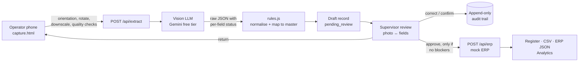

# APLYD: Solution Note

**Brief:** Vision-first shop-floor digitisation (textile manufacturing), APLYD by Athena Infonomics
**Author:** Aditya Singhani · **Live demo:** https://athenavisionloom.vercel.app

## 1. The problem, restated

Operators record loom production on paper: loom, date, shift, metres, fabric sort, lot, defects, downtime and remarks. Someone later retypes these forms into the ERP, which is slow and adds errors. The goal is to make a phone photo produce a record a supervisor can trust and approve in seconds, without pretending the AI is always right.

The design principle throughout: **the AI reads, code checks, a human decides.** The system must never turn an unreadable or ambiguous mark into a confident-looking number.

## 2. Assumptions

| # | Assumption | Why it matters |
|---|---|---|
| A1 | A photo holds one slip (one loom, one shift) **or** a register page with one row per loom. | One record per filled row. Values written once at the top (date, shift) apply to every row; empty lines are ignored. |
| A2 | Dates are written day-first (DD/MM/YY or DD/MM/YYYY). | This is Indian shop-floor convention. `05/06/26` is read as 5 June. |
| A3 | Required fields: loom, date, shift, quantity. Everything else is optional. | A blank batch is a valid outcome. A blank quantity is not. |
| A4 | The loom and shift master is the source of truth. | A reading like "L-19" that is not in the master is flagged `invalid`, never auto-corrected. |
| A5 | Operators use a mid-range Android phone on a patchy network. | Images are downscaled in the browser before upload (≈0.3–1 MB). With no signal at all, the photo waits on the phone and is read when the connection returns. |
| A6 | The ERP accepts a JSON record per production entry. | It is mocked with a versioned contract (`aplyd.production_record/v1`). |
| A7 | Prototype only: demo personas, no login, data stored in the browser. | Keeps the scope to a week. The production design is in `production-schema.sql`. |
| A8 | Forms are often submitted in a stack at shift end, not one at a time. | Batch upload (≤25 photos) alongside single capture. |
| A9 | Downtime reasons are free text on paper, but reports need categories. | Handwriting is kept as written, and mapped to an admin-editable reason list (Cleaning, Beam change, Warp/weft break, Pirn change, Power cut, Maintenance, Waiting for yarn, incl. common Hinglish words); anything else becomes OTHER with a warning. |

## 3. Architecture and data flow

- **Front end:** plain HTML/JS, no build step, designed phone-first: operators and supervisors work on shared or personal phones, so phones get a bottom tab bar, card lists, a pinned photo with full-screen zoom during review, a one-row action bar, 44 px touch targets and an installable "Add to Home Screen" app. Tablets and desktops get a sidebar layout and keyboard shortcuts. Photos taken with no signal wait in an on-device outbox.
- **Security headers:** a strict Content-Security-Policy (no inline scripts), no framing, `nosniff`; tests and docs are not deployed.
- **Serverless functions (Vercel):** `/api/extract` holds the API key and calls the model. `/api/erp` is the mock ERP. Both are under 200 lines.
- **Shared rules module (`aplyd/js/rules.js`):** the browser and the server load the same code, so both apply the same idea of "valid".

## 4. Key decisions and trade-offs

**Vision LLM instead of OCR plus template.** Classic OCR (Tesseract, cloud OCR) is reliable on print but weak on handwriting. It also needs a fixed template per form layout. A vision LLM reads handwriting, copes with layout changes (sample 9 uses a completely different ledger layout), and can report its own uncertainty per field. The costs are latency of seconds rather than milliseconds, and the risk of fluent wrong answers. The rest of the design exists to contain that risk.

**Gemini free tier as the provider (Flash-Lite first).** It is free with a Google account, has no card requirement, is among the strongest models on handwriting, and accepts images inline. The trade-offs:
- The free tier has per-minute and per-day request limits.
- Google may use free-tier inputs to improve its products. That is acceptable for a demo with synthetic forms; production would use a paid or enterprise tier.

The provider layer is pluggable: an OpenAI-compatible adapter (OpenRouter free vision models) acts as an automatic fallback when a key is set. Within Gemini, the server tries a list of models in order, so a busy or rate-limited model falls through to the next. The order is measured, not guessed: on the 6-row register page, `gemini-3.1-flash-lite` answered in 9 s and `gemini-flash-lite-latest` in 7.5 s, while `gemini-3.8-flash` hung for 25 s and `gemini-2.5-flash` took 19 s. The chain is therefore 3.5-flash-lite (most accurate when not overloaded; it fails fast with 503 when it is) → 3.1-flash-lite → flash-lite-latest → 2.5-flash, with 20 s per attempt and 50 s in total. Every record keeps the list of models tried, so a slow read is explained on the review screen.

**The model transcribes; code decides.** The prompt asks only for what is written plus a status per field: `read`, `uncertain`, `missing` or `illegible`. Everything else is deterministic code in `rules.js`:
- matching to the loom master, plus `invalid` when the loom or shift is unknown
- parsing dates day-first, and "1 hr 15 min" into 75
- unit aliases
- negative-value checks

This makes the behaviour testable (42 unit tests) and stops the model from "helpfully" fixing an unknown loom into a known one.

**Show the reviewer where each value came from.** The model also returns a box per field (where on the photo it read the value) and per register row. The review screen uses them to zoom straight to the handwriting when a field is clicked, and opens each register row zoomed to its own line. Boxes are only a navigation aid: they are sanity-checked (0–1000 range, non-zero size) and silently ignored if missing or malformed, so they never affect a value or a decision. The model also lists which fields the printed form actually has, so a register with no "defect details" column does not produce "defects not described" warnings on every row.

**Five-state field contract.** "Blank on paper" (`missing`) is different from "written but unreadable" (`illegible`), from "readable but ambiguous" (`uncertain`), and from "readable but impossible" (`invalid`). A written `0` stays `0` with status `read`; it is not treated as blank. The UI, the approval gate and the metrics all key off these states.

**Human gate, not a confidence threshold.** Self-reported model confidence is not calibrated, so the approval gate does not rely on it. Instead there are three levels:
- **AI flags block.** Any field the AI marked uncertain, illegible or invalid blocks approval until a supervisor either corrects it or confirms "value matches photo".
- **Suspicious values need a tick.** Output outside the loom's normal range (the classic misread digit: 350 read as 850) an implausible defect count (more than 10 in a shift, e.g. a 2 written over a 3 read as 32) and a possible duplicate of a pending record block approval until someone corrects the value or ticks "I checked this against the photo". The tick applies to that exact value: if the value later changes, it needs checking again. This is what catches the AI's *confident* mistakes.
- **Hard rule failures block.** Downtime longer than the shift, a future date, or a duplicate of an already-approved loom/date/shift (which would double-count in the ERP).
- **Soft anomalies warn**, and approving with them open is an explicit, recorded choice. Examples: defects counted but not described, high downtime, a downtime reason not in the list.

Every correction, undo, confirmation and check is an append-only audit entry, and each correction records what had raised the alarm on that field (AI flag, business rule, or nothing), so the reliability page can show which safety net caught each mistake.

**Fast correction without losing the audit.** A correction saves immediately with a default reason ("Checked against the photo") that can be edited inline, and the toast offers Undo; the undo is itself an audit entry and does not count as a review. Rows of a sheet or batch with nothing left to check can be approved together in one confirmed action; everything else stays one-by-one.

**No fallback that invents data.** The previous iteration of this prototype returned a canned record whenever the AI was unavailable. That was removed. If the photo is not a form, the model is down, the key is wrong, or the reply is malformed (after one automatic retry on the next model), the operator sees a specific error and nothing is saved.

**Browser storage instead of a database.** A shared database (auth, row-level security, object storage) was cut to keep the prototype runnable from a link with zero setup. The cost is that data lives per browser. The production schema with roles and an immutable audit table is in [`production-schema.sql`](production-schema.sql) as a design artifact. It is not wired up.

**Idempotent mock ERP without state.** The ERP reference is a hash of the record's idempotency key. Re-sending the same record always yields the same reference, so retries after a timeout are safe and need no server-side storage. A "simulate timeout" switch demonstrates the failure and retry path.

## 5. Handling imperfect data

| Real-world problem | What the system does |
|---|---|
| Phone held sideways, or EXIF rotation | The browser applies EXIF orientation. The operator can rotate before sending, and the model is told the page may be rotated. |
| Dim light, glare, blur, low resolution | The preflight check measures brightness, clipped highlights, Laplacian sharpness and resolution, and warns before upload. These checks warn rather than block; the model makes the final call. |
| Skew and perspective | Handled by the vision model. There is no hard dependency on a template grid. |
| Ambiguous digit (3/8, 1/7) or letter (M/N) | The model returns `uncertain` with candidates; the field is highlighted and approval is blocked until resolved. If the model is confidently wrong instead, the loom-range rule blocks approval until someone corrects the value or ticks "I checked this against the photo". |
| The AI contradicts itself (transcribes "850", returns 350) | Code compares the model's transcription with its value for numbers, durations and dates; any disagreement is flagged `uncertain`, whichever one is right. |
| Oil stain or smudge | The model returns `illegible` with no value, and the supervisor fills it from the photo or returns the form to the operator. |
| Blank field | `missing` with value null. Optional fields stay blank; required ones block. |
| Written zero | Kept as `0` with status `read`. |
| Unknown loom or shift | `invalid`, plus the reason "not in loom master". It is never auto-mapped. |
| Different form layout | The prompt finds fields by meaning, not position. Sample 9 tests this. |
| Not a form at all | The model says `is_production_form: false`, the system returns HTTP 422, the operator is told why, and nothing is saved. |
| Same photo twice | A SHA-256 duplicate warning at capture; inside a batch the exact duplicate is skipped automatically. |
| A register page listing several looms | One photo becomes one record per filled row, all linked to the same photo ("Row 3 of 6 on this sheet") and reviewed together with "Next record →". The date and shift written once at the top are applied to every row; empty lines are skipped. If the AI reports more filled rows than it returned, every record from that photo carries a "check the photo for a missed row" warning, so a row is never dropped silently. |
| A stack of sheets at shift end | Batch upload of up to 25 photos. Read two at a time so the free AI quota is not flooded; "busy" or rate-limit answers are retried automatically (after 8 s, then 20 s) before a photo is marked failed with a Retry button. Each photo becomes a normal pending record, so nothing skips review; the supervisor works through the batch with "Next record →". |
| Same loom/date/shift twice | A business-key duplicate check at review: it blocks if the other record is already approved, and needs a tick ("checked the loom number on the photo") if the other one is still pending. |
| A register with no column for a field | The model lists the fields the form has; a field blank on every row of a sheet is marked **Not on form**, so no warnings are raised about it. |
| Downtime reason written many ways | "Loom cleaning", "Cleaning" and "safai" map to one code (CLEAN); reports and the ERP payload use the code, the record keeps the handwriting. |
| No signal on the shop floor | The photo is kept on the phone (IndexedDB outbox) and read automatically when the browser is back online; nothing is lost and nothing is invented meanwhile. |
| The free AI is slow or busy | A live seconds counter, a plain explanation after 15 s, Cancel at any time; the server skips a stuck model after 20 s and the record notes which models were skipped. |
| ERP down | The record stays approved and is marked "ERP failed". It can be retried from the review screen or the register, and the retry is idempotent. |

## 6. Measuring reliability and improving over time

Two complementary measurements.

**Offline benchmark (`npm run benchmark`).** It runs the real model on labelled sample photos and reports:
- **field accuracy**
- **silent-error rate:** wrong *and* marked `read`. This is the metric that matters, because it is the only error a reviewer is likely to miss.
- **flag recall:** for fields designed to be hard, did the AI flag them?
- **blank detection**
- **unreadable-photo refusal**

The system's actual outputs per sample are saved in `aplyd/assets/sample-outputs/`.

**Results** (19 Nov 2026, Gemini free tier, final prompt incl. photo locations; produced by the script, see `aplyd/assets/benchmark/results.json`). Two sample sets:
- **Synthetic** (13): forms rendered by `tests/generate-samples.js` with handwriting fonts and simulated skew, glare, stains and tears, incl. a 6-row register page and a non-form photo.
- **Realistic** (5): photorealistic phone photos generated with an image model from detailed prompts, each answer key written by reading the finished image (not the prompt): a crumpled slip held against a loom; an 8-loom bound register with a struck-through correction ("~~412~~ 421"), a Hinglish reason and a loom stopped all shift; a Hindi (Devanagari) form; a slip with a continental "1" that looks like a 7 and a "2" written over a "3"; and a dim shed photo with tube-light glare washing out the loom number.

| Metric | Synthetic (13) | Realistic (5) |
|---|---|---|
| Field accuracy | 98.4% (189/192) | **98.3% (114/116)** |
| Silent errors (wrong but marked `read`) | 1 field | 2 fields |
| Blank fields left blank (not invented) | 100% | 100% |
| Non-form photo refused | 100% (1/1) | — |
| Median read time | 4.1 s | 8.1 s (8-row register: 20 s) |

What the AI got right on the realistic photos: the crumpled slip, the Hindi form (it kept "लाइट गई" as written and read "रात (N)" as the night shift) and the glare photo (it read the washed-out "10" as loom L-10) were all perfect; on the register it took **421**, not the struck-through 412, on all 8 rows.

The misses, and what catches them:
- **Overwritten digit read as 32 defects** (a 2 written over a 3). The model was confident. More than 10 defects in one shift is not plausible, so a business rule now blocks approval until someone checks the photo or corrects it.
- **Lot "VOI-60-323" read as "V01-60-323"** (letter O vs zero). Nothing flags this; it is a free-text code. A lot-number master (or a check digit) is the real fix; it is listed under next steps.
- **Synthetic "ambiguous digit" (350 read as 850)**: blocked by the loom-range rule until checked.
- **Synthetic unknown loom "L-19"**: flagged `uncertain` (so it blocks approval), with the AI's suggested value L-09 shown beside "Written: L-19".

How to read these numbers:
- **Runs vary.** Repeated runs on the same day ranged from 93% to 100% on the synthetic set; the low run was one reply that came back as broken JSON (the reply with photo locations is long). The server now asks the next model once when a reply is unusable, inside the same time budget.
- **The model contradicting itself is flagged by code.** In one run it transcribed "850" but returned 350; any disagreement between the transcription and the value of a number, duration or date is now marked `uncertain`.
- **18 forms is a smoke test, not an accuracy claim.** The realistic set is still generated, not photographed on a real shop floor; real forms are the next step (below).
- **Latency.** The server tries `gemini-3.5-flash-lite` first (≈4 s per slip), then the other lite models, skips a stuck model after 20 s, and stays within a 50 s total budget (Vercel's limit is 60 s).

**Live metrics (Analytics page).** These come from what supervisors did to AI output:
- correction rate
- silent-error rate, with a table of each instance (field, what was written, AI value → human value, which safety net caught it, reason)
- flag precision
- first-pass yield
- read latency
- ERP acknowledgement rate

**Improvement loop.** Silent errors are the training signal:
1. Review them weekly by field and by condition.
2. Fix the cheapest layer first: a prompt rule, a parser alias, a tighter range, a capture tip.
3. Add the photo to the labelled set so the benchmark guards against regressions.
4. Only then consider a model change.

**Honest caveat.** The bundled samples are synthetic (rendered) or AI-generated photographs. They test the pipeline and the failure handling, but real accuracy has to be measured on real photographed forms from the floor. The benchmark accepts them by adding an image plus a ground-truth entry to `tests/fixtures/samples.json`.

## 7. Limitations

- **No authentication.** Personas are switchable in the UI; the role checks exist only to demonstrate the workflow.
- **Data is per browser.** Clearing site data deletes it.
- **Free-tier limits.** Gemini's free tier caps requests per minute and per day, which is enough for a demo but not a factory.
- **Photo locations are the model's estimate.** They are usually close but can be off by a line on dense registers; they only move the viewer and never change a value.
- **The outbox needs the app open.** Photos taken offline are read when the page is open and back online; a service worker would do it in the background.
- **Brightness and blur thresholds are heuristic**, and not tuned on real phones.

## 8. Next, with more time

1. Collect 50–100 real forms from one shed, label them, and benchmark. Tune the prompt and parsers on silent errors.
2. Replace browser storage with Postgres plus object storage, using the schema in `production-schema.sql`, and add real authentication with row-level security.
3. Add a service worker so the offline outbox also works with the app closed, and the app shell loads with no signal.
4. Detect the page corners and correct perspective on the phone before upload.
5. Build a real ERP connector behind the same `aplyd.production_record/v1` contract (including the downtime reason codes).
6. Learn per-loom output ranges from approved history instead of fixed master values, so the misread-digit check tightens over time.
7. Validate lot/beam numbers against a lot master (or a check digit), so an O/0 confusion in a code is caught like an unknown loom is today.
