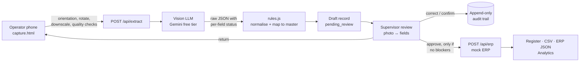

# APLYD: Solution Note

**Brief:** Vision-first shop-floor digitisation (textile manufacturing), APLYD by Athena Infonomics
**Author:** Aditya Singhani

## 1. The problem, restated

Operators record loom production on paper: loom, date, shift, metres, fabric sort, lot, defects, downtime and remarks. Someone later retypes these forms into the ERP, which is slow and adds errors. The goal is to make a phone photo produce a record a supervisor can trust and approve in seconds, without pretending the AI is always right.

The design principle throughout: **the AI reads, code checks, a human decides.** The system must never turn an unreadable or ambiguous mark into a confident-looking number.

## 2. Assumptions

| # | Assumption | Why it matters |
|---|---|---|
| A1 | A photo holds one slip (one loom, one shift) **or** a register page with one row per loom. | One record per filled row. Values written once at the top (date, shift) apply to every row; empty lines are ignored. |
| A2 | Dates are written day-first (DD/MM/YY or DD/MM/YYYY). | This is Indian shop-floor convention. `05/06/26` is read as 5 June. |
| A3 | Required fields: loom, date, shift, quantity. Everything else is optional. | A blank batch is a valid outcome. A blank quantity is not. |
| A4 | The loom and shift master is the source of truth. | A reading like "L-19" that is not in the master is flagged `invalid`, never auto-corrected. |
| A5 | Operators use a mid-range Android phone on a patchy network. | Images are downscaled in the browser before upload (≈0.3–1 MB). |
| A8 | Forms are often submitted in a stack at shift end, not one at a time. | Batch upload (≤25 photos) alongside single capture. |
| A6 | The ERP accepts a JSON record per production entry. | It is mocked with a versioned contract (`aplyd.production_record/v1`). |
| A7 | Prototype only: demo personas, no login, data stored in the browser. | Keeps the scope to a week. The production design is in `production-schema.sql`. |

## 3. Architecture and data flow

- **Front end:** plain HTML/JS, no build step, designed phone-first: operators and supervisors work on shared or personal phones, so phones get a bottom tab bar, card lists, a pinned photo with full-screen zoom during review, 44 px touch targets and an installable "Add to Home Screen" app. Tablets and desktops get a sidebar layout.
- **Serverless functions (Vercel):** `/api/extract` holds the API key and calls the model. `/api/erp` is the mock ERP. Both are under 200 lines.
- **Shared rules module (`aplyd/js/rules.js`):** the browser and the server load the same code, so both apply the same idea of "valid".

## 4. Key decisions and trade-offs

**Vision LLM instead of OCR plus template.** Classic OCR (Tesseract, cloud OCR) is reliable on print but weak on handwriting. It also needs a fixed template per form layout. A vision LLM reads handwriting, copes with layout changes (sample 9 uses a completely different ledger layout), and can report its own uncertainty per field. The costs are latency of seconds rather than milliseconds, and the risk of fluent wrong answers. The rest of the design exists to contain that risk.

**Gemini free tier as the provider (Flash-Lite first).** It is free with a Google account, has no card requirement, is among the strongest models on handwriting, and accepts images inline. The trade-offs:
- The free tier has per-minute and per-day request limits.
- Google may use free-tier inputs to improve its products. That is acceptable for a demo with synthetic forms; production would use a paid or enterprise tier.

The provider layer is pluggable: an OpenAI-compatible adapter (OpenRouter free vision models) acts as an automatic fallback when a key is set. Within Gemini, the server tries a list of models in order, so a rate limit on one falls through to the next.

**The model transcribes; code decides.** The prompt asks only for what is written plus a status per field: `read`, `uncertain`, `missing` or `illegible`. Everything else is deterministic code in `rules.js`:
- matching to the loom master, plus `invalid` when the loom or shift is unknown
- parsing dates day-first, and "1 hr 15 min" into 75
- unit aliases
- negative-value checks

This makes the behaviour testable (30 unit tests) and stops the model from "helpfully" fixing an unknown loom into a known one.

**Five-state field contract.** "Blank on paper" (`missing`) is different from "written but unreadable" (`illegible`), from "readable but ambiguous" (`uncertain`), and from "readable but impossible" (`invalid`). A written `0` stays `0` with status `read`; it is not treated as blank. The UI, the approval gate and the metrics all key off these states.

**Human gate, not a confidence threshold.** Self-reported model confidence is not calibrated, so the approval gate does not rely on it. Instead:
- Any field the AI flagged blocks approval until a supervisor either corrects it or confirms "value matches photo". Both actions are logged.
- Business-rule failures also block. Examples: downtime longer than the shift, a future date, or a duplicate of an already-approved loom/date/shift, which would double-count in the ERP.
- Softer anomalies are warnings that the supervisor accepts explicitly. Examples: output outside the loom's normal range ("check for a misread digit"), defects counted but not described.

**No fallback that invents data.** The previous iteration of this prototype returned a canned record whenever the AI was unavailable. That was removed. If the photo is not a form, the model is down, the key is wrong, or the reply is malformed, the operator sees a specific error and nothing is saved.

**Browser storage instead of a database.** A shared database (auth, row-level security, object storage) was cut to keep the prototype runnable from a link with zero setup. The cost is that data lives per browser. The production schema with roles and an immutable audit table is in [`production-schema.sql`](production-schema.sql) as a design artifact. It is not wired up.

**Idempotent mock ERP without state.** The ERP reference is a hash of the record's idempotency key. Re-sending the same record always yields the same reference, so retries after a timeout are safe and need no server-side storage. A "simulate timeout" switch demonstrates the failure and retry path.

## 5. Handling imperfect data

| Real-world problem | What the system does |
|---|---|
| Phone held sideways, or EXIF rotation | The browser applies EXIF orientation. The operator can rotate before sending, and the model is told the page may be rotated. |
| Dim light, glare, blur, low resolution | The preflight check measures brightness, clipped highlights, Laplacian sharpness and resolution, and warns before upload. These checks warn rather than block; the model makes the final call. |
| Skew and perspective | Handled by the vision model. There is no hard dependency on a template grid. |
| Ambiguous digit (3/8, 1/7) or letter (M/N) | The model returns `uncertain` with candidates. The field is highlighted, approval is blocked until resolved, and the range check against loom capacity backs this up. |
| Oil stain or smudge | The model returns `illegible` with no value, and the supervisor fills it from the photo or returns the form to the operator. |
| Blank field | `missing` with value null. Optional fields stay blank; required ones block. |
| Written zero | Kept as `0` with status `read`. |
| Unknown loom or shift | `invalid`, plus the reason "not in loom master". It is never auto-mapped. |
| Different form layout | The prompt finds fields by meaning, not position. Sample 9 tests this. |
| Not a form at all | The model says `is_production_form: false`, the system returns HTTP 422, the operator is told why, and nothing is saved. |
| Same photo twice | A SHA-256 duplicate warning at capture; inside a batch the exact duplicate is skipped automatically. |
| A register page listing several looms | One photo becomes one record per filled row, all linked to the same photo ("Row 3 of 6 on this sheet") and reviewed together with "Next record →". The date and shift written once at the top are applied to every row; empty lines are skipped. If the AI reports more filled rows than it returned, every record from that photo carries a "check the photo for a missed row" warning, so a row is never dropped silently. |
| A stack of sheets at shift end | Batch upload of up to 25 photos. Read two at a time so the free AI quota is not flooded; "busy" or rate-limit answers are retried automatically (after 8 s, then 20 s) before a photo is marked failed with a Retry button. Each photo becomes a normal pending record, so nothing skips review; the supervisor works through the batch with "Next record →". |
| Same loom/date/shift twice | A business-key duplicate check at review (it blocks if the other record is already approved). |
| ERP down | The record stays approved and is marked "ERP failed". It can be retried from the review screen or the register, and the retry is idempotent. |

## 6. Measuring reliability and improving over time

Two complementary measurements.

**Offline benchmark (`npm run benchmark`).** It runs the real model on labelled sample photos and reports:
- **field accuracy**
- **silent-error rate:** wrong *and* marked `read`. This is the metric that matters, because it is the only error a reviewer is likely to miss.
- **flag recall:** for fields designed to be hard, did the AI flag them?
- **blank detection**
- **unreadable-photo refusal**

The system's actual outputs per sample are saved in `aplyd/assets/sample-outputs/`.

**Results** (19 Nov 2026, Gemini free tier, 13 samples incl. a 6-loom register page; produced by the script, see `aplyd/assets/benchmark/results.json`):

| Metric | Result |
|---|---|
| Field accuracy | **99.5%** (191 of 192 fields, 12 forms; the register page scored 60/60 across all 6 rows) |
| Silent-error rate | 0.5% (1 field) |
| Blank fields left blank (not invented) | 100% |
| Non-form photo refused | 100% (1 of 1) |
| Flag recall on designed-hard fields | 33% (1 of 3) |

How to read these numbers:
- **The one error is on the "ambiguous digit" form.** The model read 350 as 850 and marked it `read`. The loom range rule caught it anyway: 850 is above L-12's 800 m maximum, so the review screen shows *"check for a misread digit"*. This is why the rule layer exists.
- **Low flag recall is mostly a weakness in the synthetic samples, not the model.** The model read the oil-stained text correctly, so there was nothing to flag. On inspection, the rendered "ambiguous" digit also looks more like an 8 than a 3. Real photos of real smudges are needed to measure flagging properly.
- **12 synthetic forms is a smoke test, not an accuracy claim.** It shows the pipeline works end to end and fails safely.
- **Latency.** The median was about 58 s on that run, because the server tried Google's newest Flash model first and it was overloaded. Two fixes followed. The server now tries `gemini-3.5-flash-lite` first; it produced most of the correct reads above and answers in **2–4 s**, with newer models kept as fallbacks. It also enforces a 50 s total budget across models (Vercel's limit is 60 s).

**Live metrics (Analytics page).** These come from what supervisors did to AI output:
- correction rate
- silent-error rate, with a table of each instance (field, what was written, AI value → human value, reason)
- flag precision
- first-pass yield
- read latency
- ERP acknowledgement rate

**Improvement loop.** Silent errors are the training signal:
1. Review them weekly by field and by condition.
2. Fix the cheapest layer first: a prompt rule, a parser alias, a tighter range, a capture tip.
3. Add the photo to the labelled set so the benchmark guards against regressions.
4. Only then consider a model change.

**Honest caveat.** The bundled samples are synthetic: handwriting fonts plus simulated skew, glare, stains and tears. They test the pipeline and the failure handling, but real accuracy has to be measured on real photographed forms from the floor. The benchmark accepts them by adding an image plus a ground-truth entry to `tests/fixtures/samples.json`.

## 7. Limitations

- **No authentication.** Personas are switchable in the UI; the role checks exist only to demonstrate the workflow.
- **Data is per browser.** Clearing site data deletes it.
- **Free-tier limits.** Gemini's free tier caps requests per minute and per day, which is enough for a demo but not a factory.
- **No field-to-image highlighting.** The model returns no coordinates, so the reviewer finds each value on the photo by eye.
- **Brightness and blur thresholds are heuristic**, and not tuned on real phones.

## 8. Next, with more time

1. Collect 50–100 real forms from one shed, label them, and benchmark. Tune the prompt and parsers on silent errors.
2. Replace browser storage with Postgres plus object storage, using the schema in `production-schema.sql`, and add real authentication with row-level security.
3. Add an offline capture queue (IndexedDB and a service worker) for sheds with poor Wi-Fi.
4. Ask the model for bounding boxes so the review screen can highlight each field on the photo.
5. Detect the page corners and correct perspective on the phone before upload.
6. Build a real ERP connector behind the same `aplyd.production_record/v1` contract.
